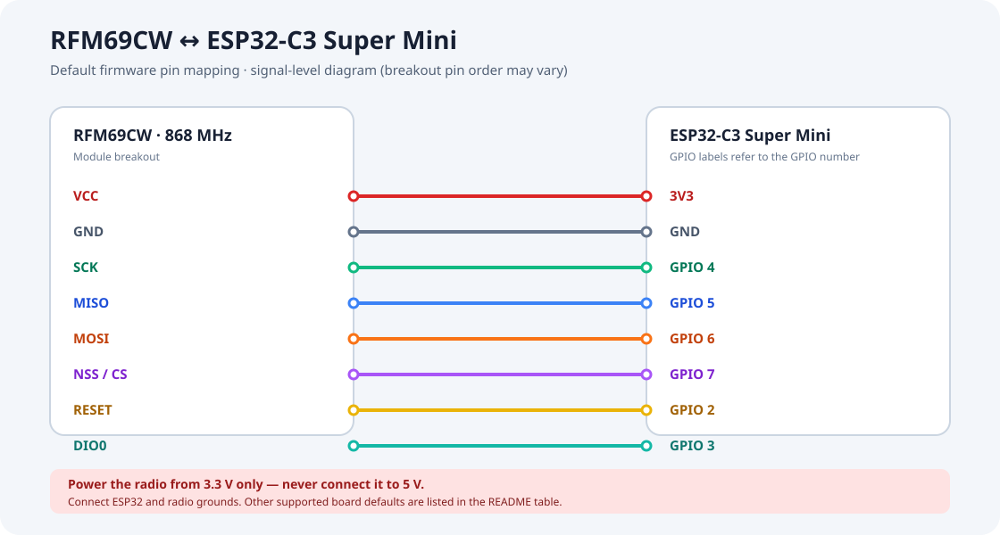
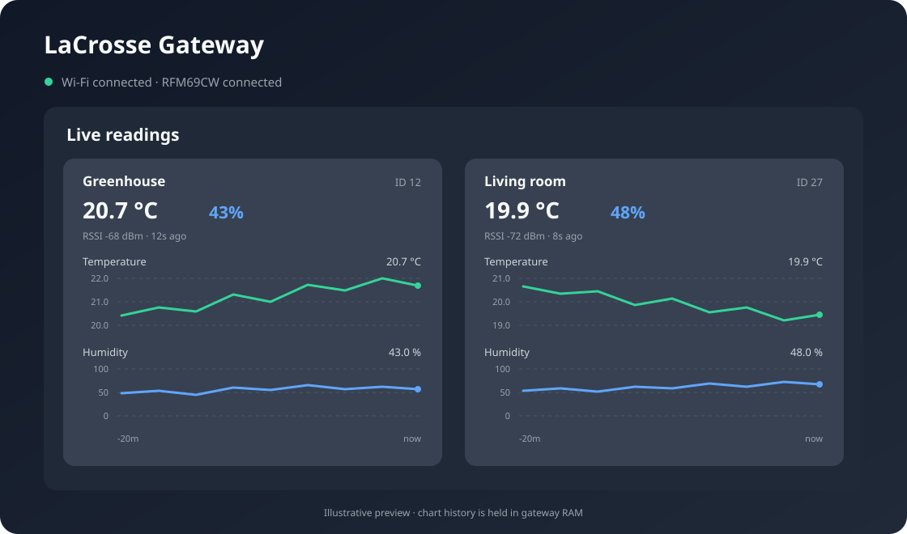

# LaCrosse MQTT Gateway — ESP32-Edition

[English](README.md) | [Deutsch](README.de.md)

ESP32-Firmware zum Empfang von LaCrosse-kompatiblen Temperatur-/Luftfeuchtigkeitssensoren auf 868 MHz mit einem RFM69CW. Die Messwerte werden per MQTT veröffentlicht und über ein lokales Dashboard angezeigt. Dies ist eine erste Implementierung zum Testen der Hardware. Prüfen Sie das Funkprofil mit Ihrem konkreten Technoline-Modell.

## Hardware und unterstützte Boards

Verwenden Sie ein ESP32-Board, ein **868-MHz-RFM69CW**, eine geeignete Antenne und 3,3-V-Logik. Verbinden Sie das Funkmodul niemals mit 5 V. Verbinden Sie die Masseleitungen von ESP32 und Funkmodul.

| PlatformIO-Umgebung | Board-ID | Beispielbelegung für das RFM69 (SCK / MISO / MOSI / NSS / RESET / DIO0) |
|---|---|---|
| `esp32dev` | `esp32dev` | `18 / 19 / 23 / 5 / 27 / 26` |
| `esp32-c3-super-mini` | `esp32-c3-devkitm-1` | `4 / 5 / 6 / 7 / 2 / 3` |
| `esp32-s2-mini` | `lolin_s2_mini` | `12 / 13 / 11 / 10 / 9 / 8` |

Die Abbildung zeigt die Standardverdrahtung für das ESP32-C3 Super Mini; die Tabelle oben enthält die Vorgaben für die anderen Boards.



Dies sind Standardbelegungen. Prüfen Sie die genaue Board-Revision und wählen Sie unter **Network / MQTT → RFM69 GPIO pins** unterstützte, unterschiedliche GPIOs aus. SCK, MOSI, NSS und RESET müssen als Ausgänge verwendbare Pins sein. Die Einstellungen werden gespeichert und nach einem Neustart angewendet. Die `RADIO_PIN_*`-Einträge in `platformio.ini` dienen weiterhin als Standardwerte beim ersten Start. DIO0 ist zugeordnet; die Firmware fragt das Funkmodul derzeit jedoch über SPI ab.

### Build, Flashen und Tests

Installieren Sie PlatformIO und führen Sie folgende Befehle aus:

```sh
pio run -e esp32dev
pio run -e esp32-c3-super-mini
pio run -e esp32-s2-mini
pio test -e esp32dev
pio run -e esp32dev -t upload
pio device monitor
```

Die Weboberfläche ist in der Firmware eingebettet; ein Dateisystem muss nicht separat hochgeladen werden.
Die Weboberfläche zeigt die in der Firmware eingebettete Release-Version an. Bei lokalen Builds wird `git describe --tags --always --dirty` verwendet, sodass bei nicht markierten oder geänderten Builds zusätzlich Commit und Änderungsstatus angezeigt werden.

Für die Erstinstallation können Sie den [Online-USB-Flasher](https://wunderbaum.github.io/lacrosse-mqtt-gateway-esp32-rfm69-mqtt-dashboard/) oder PlatformIO verwenden. Der Online-Flasher benötigt einen Web-Serial-kompatiblen Browser, ein USB-Datenkabel und eine HTTPS-Verbindung.

## Releases und Online-Flasher

Unter [GitHub Releases](https://github.com/wunderbaum/lacrosse-mqtt-gateway-esp32-rfm69-mqtt-dashboard/releases) finden Sie die kompilierten Firmware-Dateien. Jedes Release enthält eine OTA-Anwendungsdatei (`*-ota.bin`) für die Seite **Firmware update** des Gateways sowie Bootloader-, Partitionstabellen- und `boot_app0`-Dateien für das USB-Flashen.

Ein Release wird durch einen Versions-Tag erstellt, zum Beispiel:

```sh
git tag v0.2.0
git push origin v0.2.0
```

GitHub Actions erstellt die Firmware für alle drei Boards, veröffentlicht das Release und aktualisiert den Online-Flasher. Tags mit dem Präfix `v0.` werden als Vorabversionen markiert. Der Online-Flasher fragt, ob vorhandene Flash-Daten gelöscht werden sollen. Sichern Sie benötigte Einstellungen vorher.

## Einrichtung

1. Beim ersten Start erstellt das Gateway den WLAN-Access-Point `LaCrosse-Gateway` mit dem Passwort `lacrosse868`.
2. Verbinden Sie sich damit und öffnen Sie `http://192.168.4.1/`.
3. Tragen Sie unter **Network / MQTT** die WLAN- und MQTT-Broker-Daten ein. Passen Sie bei Bedarf auch die RFM69-GPIOs oder die Empfangsbandbreite an und speichern Sie die Einstellungen. Das Gateway startet anschließend neu.
4. Öffnen Sie die LAN-IP-Adresse des Gateways und benennen Sie unter **Sensor setup** erkannte Sensoren und aktivieren oder deaktivieren Sie deren MQTT-Veröffentlichung. Um Nachbar- oder unbekannte Sensoren zu ignorieren, aktivieren Sie die Sensor-Whitelist und deaktivieren Sie bereits erkannte IDs, denen Sie nicht vertrauen. Die Whitelist ist standardmäßig ausgeschaltet; bekannte Sensoren sind zunächst zugelassen, unbekannte Funk-IDs werden bei aktiver Whitelist ignoriert. Der ausdrücklich gestartete Batteriewechsel kann weiterhin eine Ersatz-ID erfassen und bestätigen.

Das Dashboard zeichnet die letzten Temperatur- und Luftfeuchtigkeitsmessungen auf. Das Gateway speichert bis zu 48 Messungen gemeinsam für alle Sensoren im RAM; nach einem Neustart ist dieser Verlauf gelöscht.



Um einen Sensor nach einem Batteriewechsel zu ersetzen, klicken Sie vor dem Einlegen der Batterie auf **Battery change** in der Sensorkarte. Das Gateway sucht 30 Sekunden nach Funk-IDs und zeigt neu erkannte IDs zur Bestätigung an. Nach der Bestätigung bleiben Sensorname, MQTT-Topic und Home-Assistant-Entitäts-IDs erhalten; die neue Funk-ID wird auch nach einem Neustart verwendet. Es kann jeweils nur ein Austausch gleichzeitig vorgemerkt sein.

Das Dashboard zeigt an, ob beim Start ein RFM69CW erkannt wurde. Dazu wird geprüft, ob das SPI-Versionsregister den Wert `0x24` zurückgibt. Andernfalls überspringt die Firmware die Funkabfrage. Prüfen Sie Stromversorgung und SPI-Verkabelung, wenn das Modul nicht erkannt wird.

Ändern Sie vor dem Einsatz das Passwort des Setup-Access-Points in `src/main.cpp`. Legen Sie unter **Network / MQTT** ein OTA-Passwort mit mindestens 8 Zeichen fest. Öffnen Sie anschließend **Firmware update** und laden Sie die passende Datei `.pio/build/<environment>/firmware.bin` oder das `*-ota.bin`-Release-Asset hoch. Für Firmware-Uploads ist dieses Passwort erforderlich; nach einem erfolgreichen Update startet das Gateway neu.

Der übrige Teil der lokalen Weboberfläche ist nicht authentifiziert. Die OTA-Passwortprüfung verwendet HTTP Basic über unverschlüsseltes HTTP; das Passwort ist daher bei der Übertragung nicht verschlüsselt. Verwenden Sie die Oberfläche nur in einem vertrauenswürdigen Netzwerk und machen Sie sie nicht direkt aus dem Internet erreichbar.

## MQTT und Home Assistant

Der Zustand wird retained unter `<base-topic>/sensor/<name-slug>/state` veröffentlicht. Das Standard-Basistopic ist `lacrosse`. Das JSON enthält `id` (die aktuelle Funk-ID), `logical_id` (die stabile Sensoridentität), `temperature`, `humidity`, `battery_low`, `new_battery`, `rssi` und die Laufzeit `updated`.

Bei jeder MQTT-Verbindung veröffentlicht das Gateway retained Home-Assistant-MQTT-Discovery-Konfigurationen für Temperatur, Luftfeuchtigkeit und niedrigen Batteriestand. Die Discovery-Topics liegen unter `homeassistant/` und verwenden stabile, logische sensor-ID-basierte Kennungen, die auch nach Bestätigung einer neuen Funk-ID erhalten bleiben. Die drei Entitäten eines Sensors werden als ein Gerät gruppiert. Zusätzlich veröffentlicht das Gateway den retained Online-/Offline-Status unter `<base-topic>/status`. Beim Deaktivieren eines Sensors werden dessen gespeicherte Discovery-Konfigurationen gelöscht, sodass Home Assistant die Entitäten entfernt. Beim Umbenennen wird die Discovery-Konfiguration aktualisiert; die eindeutigen Kennungen bleiben stabil.

Die MQTT-Integration von Home Assistant muss mit demselben Broker verbunden sein. Das Discovery-Präfix ist standardmäßig `homeassistant`.

## Funkprofil und Einschränkungen

Das initiale Funkprofil verwendet FSK mit 868,300 MHz, 17,241 kbit/s, 90 kHz Frequenzhub, dem Synchronwort `2D D4`, einem festen Empfangsrahmen von fünf Bytes und einer LaCrosse-artigen CRC-8-Prüfsumme mit Polynom `0x31`. Temperatur-only-Rahmen mit der LaCrosse-Kennung für fehlende Luftfeuchtigkeit (`0x6A`) werden unterstützt; für diese Sensoren werden weder Luftfeuchtigkeitswerte noch eine MQTT-Discovery-Entität veröffentlicht. Die Empfangsbandbreite kann unter **Network / MQTT → RFM69 receive bandwidth** auf 125, 200 oder 250 kHz eingestellt werden; Standardwert ist 250 kHz. Ein breiterer Filter kann bei schwachen oder leicht frequenzverschobenen Signalen helfen, nimmt aber auch mehr Störungen auf. Änderungen werden nach einem Neustart angewendet. Decoder-Unit-Tests prüfen gültige Rahmen, reine Temperatur-Rahmen, Temperatur-/Luftfeuchtigkeits-/Batterie-Dekodierung sowie ungültige CRC-, Header-, BCD- und Luftfeuchtigkeitsdaten.

Technoline ist eine Marke mit verschiedenen Funkprotokollen. Ein erfolgreicher Firmware-Build oder bestandene Tests belegen nicht, dass ein bestimmtes Sensormodell genau dieses Funkformat verwendet. Prüfen Sie den Empfang mit Ihrer Hardware und nennen Sie das Modell oder stellen Sie Funkmitschnitte bereit, falls der Sensor nicht erkannt wird. Dieses initiale Funkprofil ist nicht für alle Technoline-Sensoren validiert.
